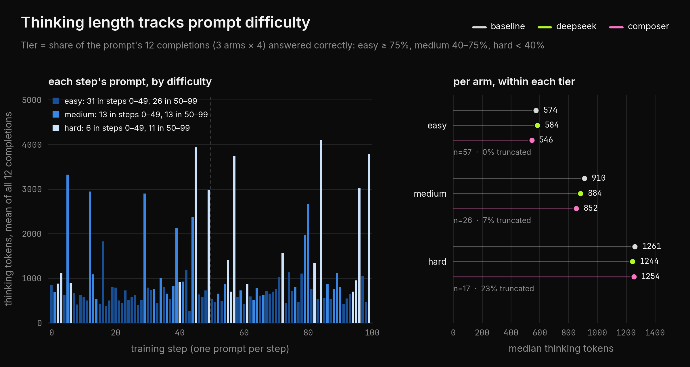

# thinking-token length penalties: capped-linear vs concave

Can a length penalty make a reasoning model think less without getting worse?
I trained `Qwen/Qwen3-1.7B` with GRPO on GSM8K using two penalty shapes,
DeepSeek's capped linear and Composer's concave. One seed and 100 steps per
arm, so treat the results as a hint, not proof.

## the two penalties

A correct answer gets $2 + r_{\text{length}}(L)$, where $L$ is the number of
thinking tokens. Wrong or unfinished answers get 0.

- **DeepSeek (capped linear):** $r = -\min(\text{cap},\ \text{strength} \cdot L/T)$.
  Grows with length, then goes flat at the cap.
- **Composer (concave):** $r = -\text{anchor} \cdot g(L)/g(T)$ with
  $g(L) = \frac{1-(1+\kappa L)^{1-q}}{\kappa(q-1)}$, $q = 1.5$. Keeps growing,
  but more slowly for longer answers.

Both cost −0.5 at $T = 512$ tokens, so only the shape differs. Past 512 they
split: at 4096 tokens Composer costs more than twice as much.


## setup

Three arms that differ only in reward: **baseline** (no penalty,
`qwen_normal.py`), **deepseek** and **composer** (`qwen_length.py --penalty
...`). Same data order and seed, one GSM8K prompt per step with 4 completions,
4096-token limit, LoRA rank 16. TRL 1.15.0 GRPO + vLLM, about 15 min per arm
on one A100 40 GB.

## training


Every arm sees the same prompt at each step, so these lines mostly move
together with how hard that prompt is, not with training.



A prompt is "hard" if under 40% of its 12 completions (3 arms × 4) were
correct. Hard prompts take about twice the tokens and hit the limit 23% of the
time. 11 of the 17 land in the second half, which is why length rises late.
Within a tier the penalty changes length by 60 tokens at most; composer is
shortest on easy and medium prompts.

## results

Greedy GSM8K, 128 held-out questions:

| arm | accuracy | total tokens | correct per 1000 tokens |
| --- | --- | --- | --- |
| frozen base | 54.7% | 167k | 0.42 |
| baseline | 64.1% | 160k | 0.51 |
| deepseek | 65.6% | 171k | 0.49 |
| **composer** | **65.6%** | **153k** | **0.55** |


Both penalties keep accuracy. Only composer cuts tokens here (4% fewer than
baseline). DeepSeek doesn't, likely because most answers are already past its
cap.

pass@4 (64 questions, 4 samples at temperature 0.8). Hollow dot: one sample
correct. Filled dot: at least one of 4 correct.


DeepSeek is best on GSM8K (90.6%), composer on the harder MATH-500 (25.0%).

## strength ablation

Strength 0.125, 0.5 and 0.75 for each shape. Separate eval run, so the
frozen base scores 58.6% here.


| arm | accuracy | total tokens |
| --- | --- | --- |
| frozen base | 58.6% | 168,890 |
| baseline | 64.1% | 161,090 |
| deepseek 0.125 / 0.5 / 0.75 | 63.3% / 63.3% / 64.8% | 162k / 153k / 160k |
| composer 0.125 / 0.5 / 0.75 | 64.1% / **68.0%** / 60.2% | 157k / 158k / 168k |

Composer 0.5 is the best arm (68.0%); at 0.75 its never-flat cost hurts
accuracy. Deepseek 0.5 was the shortest arm in this re-run (153k vs 171k in
the first), so token savings are not stable across runs.


## takeaways

- Both shapes keep accuracy at strength 0.5.
- Token savings are small and vary by run: composer saved tokens in both
  runs, deepseek in one.
- The capped penalty stops pushing once answers pass the cap, and most do.
- The concave penalty needs care: 0.5 works, 0.75 is too strong.
- Limits: one seed; gaps between arms are a few questions out of 128.
  Paired bootstrap CIs are in `runs/analysis-local/`.

## reproducing

```bash
# train one arm (about 15 min on one A100 40 GB)
accelerate launch qwen_normal.py --model qwen-small --use-vllm --dataset gsm8k \
  --steps 100 --max-completion-length 4096 --norm 512 \
  --composer-k 0.001953125 --seed 42 --output runs/arms/base
# penalty arms: qwen_length.py with --penalty deepseek --strength 0.5 --cap 0.5
#               (or --penalty composer), other flags the same

# evaluate and compare
python evaluate.py --model qwen-small \
  --adapter deepseek=runs/arms/ds --adapter composer=runs/arms/co \
  --dataset gsm8k --samples 128 --output runs/eval/gsm8k
python analyze.py --eval-dir runs/eval/gsm8k --arm deepseek --arm composer \
  --output runs/analysis.json

# figures (read from runs/logs and runs/analysis-local)
python plot.py && python fig_sweep.py && python fig_strength_bars.py && python fig_strength_roll.py
```

Adapters on HF: `Pradheep1647/grpo-think-len-baseline`,
`Pradheep1647/grpo-think-len-capped-linear`,
`Pradheep1647/grpo-think-len-concave`. Run archives are in
`runs/logs/length-qwen17-run-38c53964/` and
`runs/logs/length-qwen17-ablation-fd2b4145/` (gitignored).
