# thinking-token length penalties: capped-linear vs concave

A small GRPO experiment on `Qwen/Qwen3-1.7B` with GSM8K. I compared two ways
to penalize long thinking: DeepSeek's capped linear penalty and Composer's
concave penalty. One seed, 100 steps per arm. This is a blog-scale run, so
treat the numbers as a good hint, not a proof.

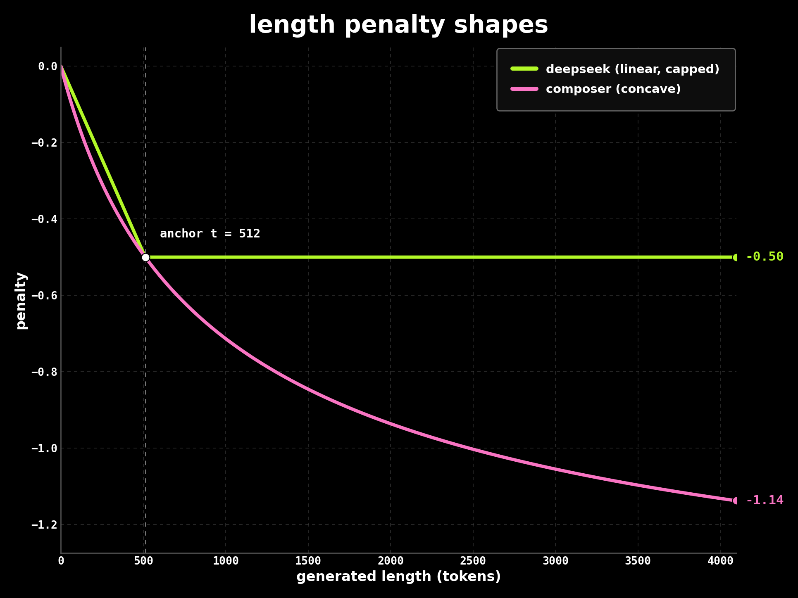

## setup

Three to seven matched arms. Same data order, seed, group of 4 completions
per prompt, 4096-token cap, LoRA rank 16. Reward for a correct, finished
answer:

- **baseline** (`qwen_normal.py`): $+2$
- **deepseek** (`qwen_length.py --penalty deepseek`): $2 - \min(0.5,\ 0.5\,L/512)$
- **composer** (`qwen_length.py --penalty composer`): $2 - 0.5\,g(L)/g(512)$,
  $g(L)=\frac{1-(1+L/512)^{1-q}}{(q-1)/512}$, $q=1.5$

## the two formulations

The reward only counts answers that finish thinking and parse to the right
integer. For those, with thinking length $L$:

$$r = 2 + r_{\text{length}}(L)$$

**DeepSeek, capped linear.** The cost grows in proportion to length and stops
at a cap:

$$r_{\text{length}}(L) = -\min\!\left(\text{cap},\ \frac{\text{strength} \cdot L}{T}\right)$$

Once a completion passes the cap it pays nothing extra, so very long answers
feel no extra pressure. That is the known weak point.

**Composer, concave.** A $q$-log curve with shape parameter $q>1$ and scale
$\kappa$:

$$g(L) = \frac{1-(1+\kappa L)^{1-q}}{\kappa\,(q-1)}, \qquad r_{\text{length}}(L) = -\text{anchor} \cdot \frac{g(L)}{g(T)}$$

It grows forever but with a falling slope: cheap near the anchor, then a long
tail that still matters at 4096 tokens. No cap, but the concave bend keeps it
below the $+2$ reward.

**Matching.** Both curves are scaled so they cost exactly the same at the
anchor $T$, here 512 tokens. So the comparison is only about the shape, not
the overall strength. In this run both cost $-0.5$ at $T$.

Training ran TRL 1.15.0 GRPO with colocated vLLM on one A100 40 GB, about 9 s
per step, 15 min per arm.

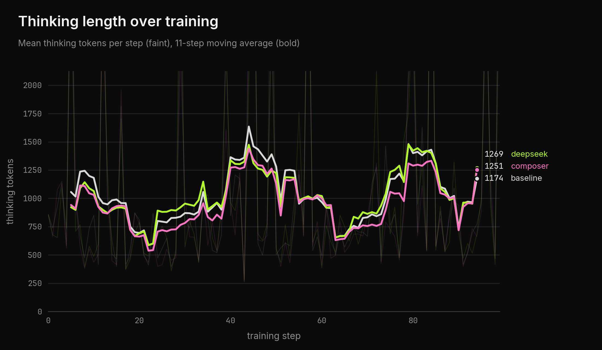
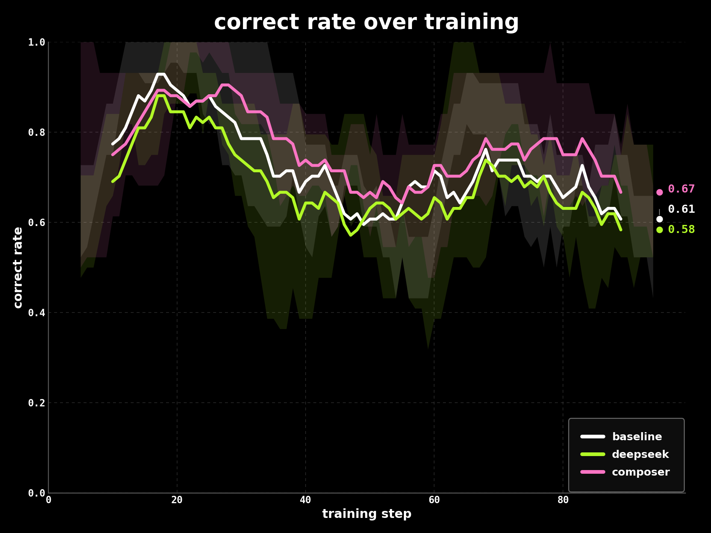

## results

Held-out gsm8k greedy (128 questions, temperature 0):

| arm | accuracy | total tokens | correct per 1000 tokens |
| --- | --- | --- | --- |
| frozen base | 54.7% | 167k | 0.42 |
| baseline | 64.1% | 160k | 0.51 |
| deepseek | 65.6% | 171k | 0.49 |
| **composer** | **65.6%** | **153k** | **0.55** |

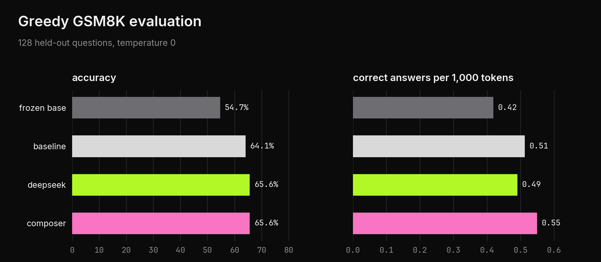

Strength ablation, same gsm8k setup:

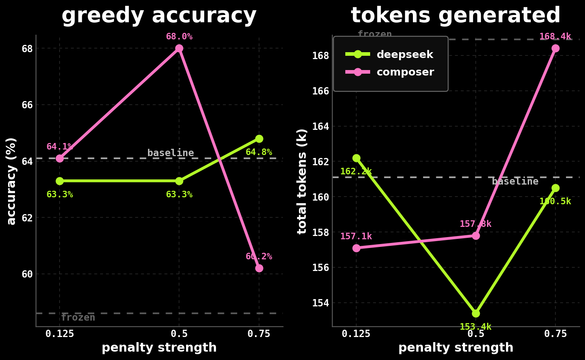

| arm | accuracy | total tokens |
| --- | --- | --- |
| frozen base | 58.6% | 168,890 |
| baseline (no penalty) | 64.1% | 161,090 |
| deepseek 0.125 | 63.3% | 162,194 |
| deepseek 0.5 | 63.3% | 153,432 |
| deepseek 0.75 | 64.8% | 160,465 |
| composer 0.125 | 64.1% | 157,125 |
| **composer 0.5** | **68.0%** | 157,844 |
| composer 0.75 | 60.2% | 168,368 |

pass@1 and pass@4 by strength:

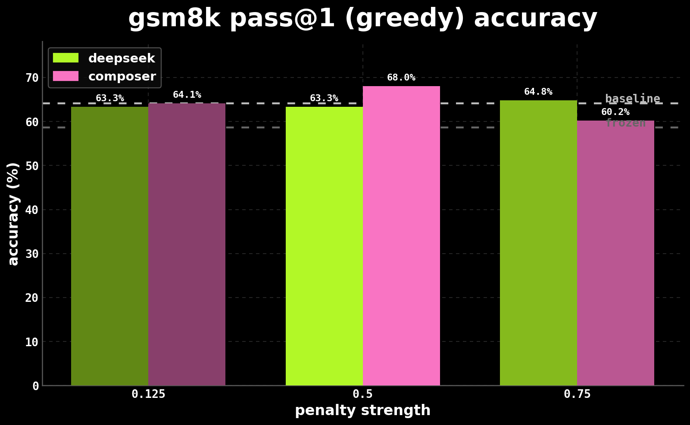
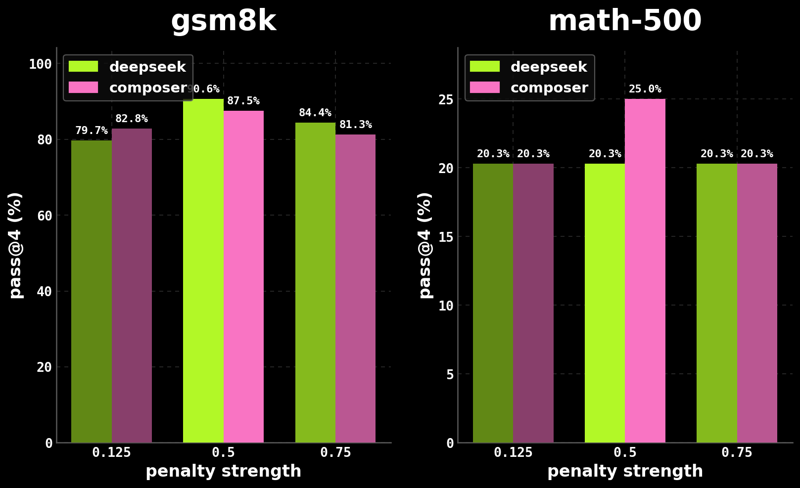

pass@4 (64 questions, temperature 0.8):

| arm | gsm8k | math-500 |
| --- | --- | --- |
| frozen base | 82.8% | 17.2% |
| baseline | 79.7% | 23.4% |
| deepseek 0.5 | **90.6%** | 20.3% |
| composer 0.5 | 87.5% | **25.0%** |

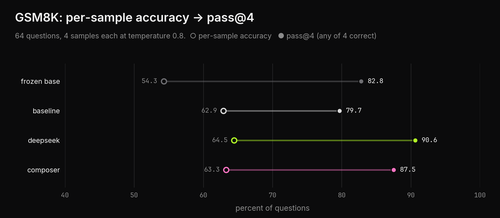
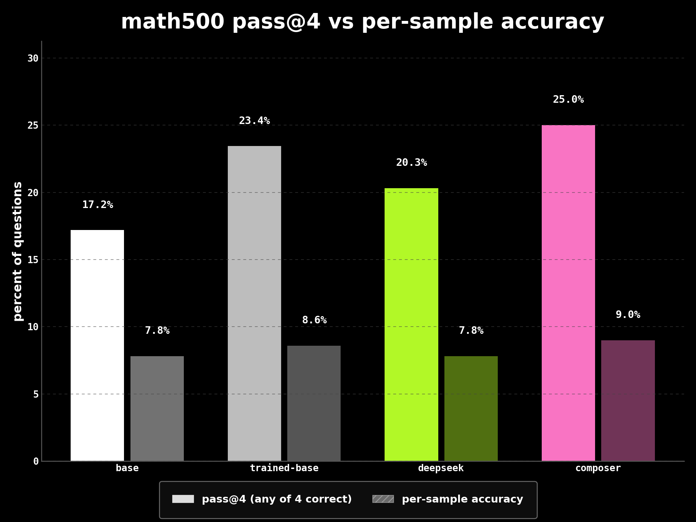

ablation training curves:

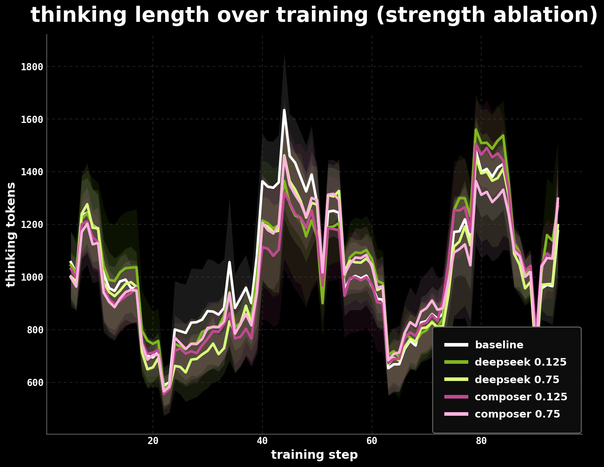
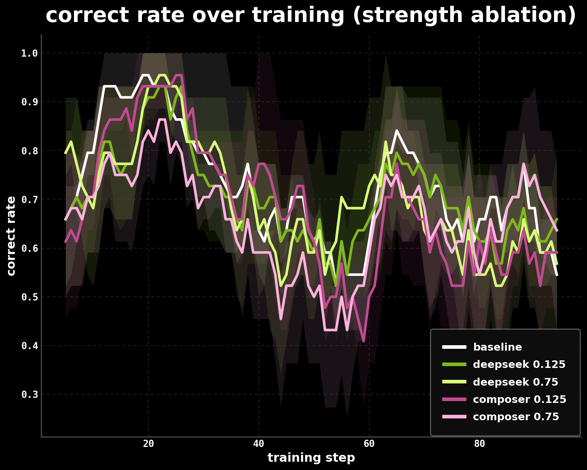

## what I take from this

Both penalties matched baseline accuracy, but only the concave one actually
used fewer tokens, about 10% less than the trained baseline. The capped
linear one barely changed length at all, because most answers sat inside its
cap. Composer at 0.5 was the best greedy arm and the best on hard math-500.
Pushing it to 0.75 was too much (60.2%), since the concave curve keeps
charging past the anchor. DeepSeek had the best gsm8k pass@4.

Honest limit: deltas between the penalty arms are a few questions wide at
128 questions, and this is one seed. Paired bootstrap CIs are in
`runs/analysis-local/`.

## reproducing

```bash
# train, each arm about 15 min on one A100 40 GB
accelerate launch qwen_normal.py --model qwen-small --use-vllm   --dataset gsm8k --steps 100 --max-completion-length 4096   --norm 512 --composer-k 0.001953125 --seed 42 --output runs/arms/base
# penalty arms: qwen_length.py plus --penalty deepseek --strength 0.5 --cap 0.5
#               (or --penalty composer), same other flags

python evaluate.py --model qwen-small   --adapter deepseek=runs/arms/ds --adapter composer=runs/arms/co   --dataset gsm8k --samples 128 --output runs/eval/gsm8k
python analyze.py --eval-dir runs/eval/gsm8k --arm deepseek --arm composer   --output runs/analysis.json
python plot.py --logs runs/arms/*/reward_samples.jsonl --outdir figures
```

Adapters on HF: `Pradheep1647/grpo-think-len-baseline`,
`Pradheep1647/grpo-think-len-capped-linear`,
`Pradheep1647/grpo-think-len-concave`. The verified run archive (logs,
configs, rewards, checkpoints, evals) is under
`runs/logs/length-qwen17-run-38c53964/` and
`runs/logs/length-qwen17-ablation-fd2b4145/`. `runs/` is gitignored.
